# Air Quality Analysis and 7-Day AQI Forecasting in Denpasar, Bali

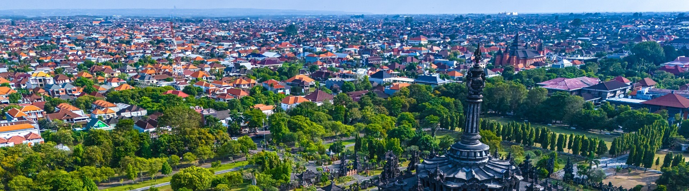
<br> *Photo: Depositphotos*

How clean is the air in Denpasar, what makes it worse, and what will the next week bring? This
project answers those three questions with daily air quality and weather data from **August 2022 to
October 2026**. It also builds a model that forecasts the **US Air Quality Index (AQI)** for the next
seven days.

The analysis lives in [`notebooks/air-quality-predictive-analysis.ipynb`](notebooks/air-quality-predictive-analysis.ipynb).
This README retells the notebook in plain language, section by section, without any code. The
results also feed a bilingual (Indonesian and English) Streamlit dashboard in [`dashboard/`](dashboard/).

<!-- STREAMLIT CLOUD PLACEHOLDER: after deploying, replace every YOUR-APP-NAME in this README
     (here and in How to Run) with the app's name on Streamlit Community Cloud. -->
[](https://YOUR-APP-NAME.streamlit.app)

**Try the dashboard online:** [https://YOUR-APP-NAME.streamlit.app](https://YOUR-APP-NAME.streamlit.app), or run it on your own computer (see
[How to Run](#how-to-run)).

## At a glance

| Question | Answer |
|---|---|
| How clean is the air? | Mostly **Moderate**. The average daily AQI is **52** on a scale where 0–50 is *Good* and 51–100 is *Moderate*. |
| How often is it unhealthy? | Rarely: only **5 of 1,548 days (0.3%)** went above AQI 100, all between November and February. |
| Is it getting better or worse? | Neither. The yearly average stayed between **50.6 and 52.9**. |
| What is the main pollutant? | **Fine particles (PM2.5)**. Their average, **11.0 µg/m³**, is more than twice the World Health Organization's annual guideline of 5 µg/m³. |
| What helps? | **Rain** cleans the air, up to a point. **Wind** mainly disperses traffic and combustion gases. |
| How good is the forecast? | It puts **77%** of forecasts in the correct AQI category, better than two simple rules of thumb. It is most reliable for the **next 3 days** (78–90% correct). |
| Next week (31 Oct – 6 Nov 2026) | AQI **54 to 56** every day, all *Moderate*. **No health advisory needed.** |

### How the notebook is organised

The work follows **CRISP-DM**, a standard step-by-step method for data projects: understand the
problem, understand the data, prepare it, build models, evaluate them, and put them to use.

| # | Section | What it covers |
|---|---|---|
| 1 | [Project Overview](#1-project-overview) | Why air quality in Denpasar matters |
| 2 | [Business Understanding](#2-business-understanding) | Problems, goals, people involved, and how success is measured |
| 3 | [Setup](#3-setup) | The tools used |
| 4 | [Data Understanding](#4-data-understanding) | Where the data come from, how clean they are, and what they show |
| 5 | [Data Preparation](#5-data-preparation) | Turning the data into something a model can learn from, without cheating |
| 6 | [Modelling](#6-modelling) | Building and choosing the forecasting model |
| 7 | [Evaluation](#7-evaluation) | How well the model works on data it has never seen |
| 8 | [Forecasting and Export](#8-forecasting-and-export) | The 7-day forecast and the files for the dashboard |
| 9 | [Conclusion and Recommendations](#9-conclusion-and-recommendations) | What it all means and what to do about it |

To run the dashboard yourself, see [How to Run](#how-to-run).

The notebook departs from the textbook order of CRISP-DM in two places, on purpose:

* **The data are merged and cleaned before they are explored (Section 4.4).** Exploration needs one
  tidy daily series to look at.
* **The data are split into training and test periods early (Section 5).** This way, every
  preparation step learns from the past only.

---

## 1. Project Overview

**Bali's clean-air image is both a public health asset and an economic one, and protecting it takes
evidence.**

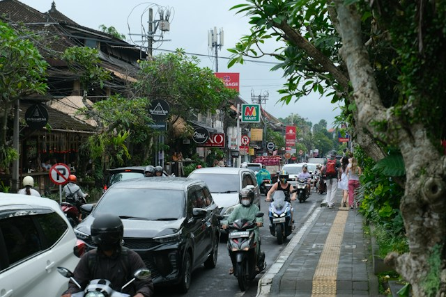
<br> *Photo: Anil Baki Durmus, licence under Unsplash (2025)*

**Air pollution is a major health risk.**

* The World Health Organization (WHO) estimates that air pollution causes about **seven million
  early deaths** worldwide every year.
* In 2021 the WHO tightened its annual guideline for fine particles (PM2.5) to **5 µg/m³**.

**Indonesia is heavily exposed.**

* Almost all of its 276 million people live where yearly PM2.5 is above the WHO guideline.
  Exposure is 61.7% higher than in 1998.
* Meeting the guideline would add about **1.3 years** to the average Indonesian's life.
* The harm goes beyond the lungs. A study of more than 640,000 Indonesians found that every extra
  10 µg/m³ of PM2.5 raised the odds of diabetes by 9%.

**Pressure on Denpasar is growing.** Bali welcomed a record **6.95 million foreign visitors in
2025**, 9.72% more than in 2024. Every extra visitor means more traffic, energy use, and waste. Waste
has already caused pollution episodes:

* **October 2023:** a fire spread across nearly half of the 32-hectare Suwung landfill in southern
  Denpasar. The city declared an emergency, set up health posts, and handed out masks.
* **2026:** after the landfill began closing in phases, rubbish piled up around the city, and
  residents reported burning household waste in the open.

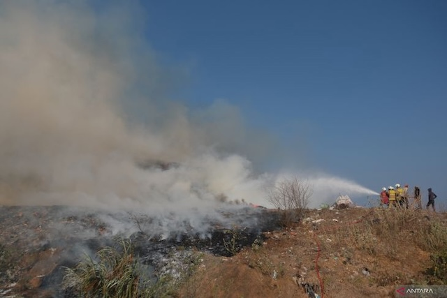
<br> *Photo: Nyoman Hendra Wibowo, licence under ANTARANews Bali (2023)*

**The good news: much of the pollution is local, so it can be controlled.** During **Nyepi**, the
Balinese Day of Silence, almost all activity stops, and the air clears quickly:

* Airborne particles fell by **73–78%** at urban sites in Bali.
* In 2022, PM2.5 dropped by about **47%** compared with the 2020–2022 average, together with
  lower carbon monoxide and nitrogen dioxide.

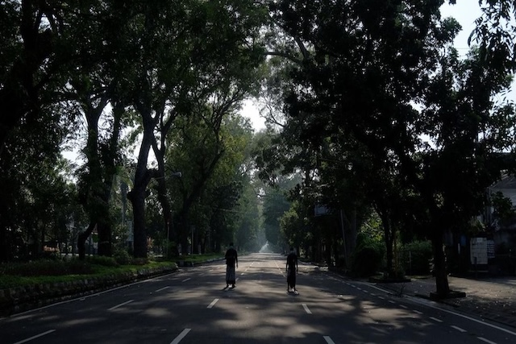
<br> *Photo: Ni Luh Made Yari Purwani Sasih, licence under detik.com (2023)*

In short, **people decide how much pollution is released, and the weather decides how long it
stays in the air.**

**What this project delivers.** Using daily data for Denpasar from August 2022 to October 2026, it
answers three practical questions for decision-makers:

1. How has air quality changed over time?
2. Which conditions lead to high-AQI (poor air) days?
3. What are the next seven days likely to bring?

All sources are listed under [References](#references).

---

## 2. Business Understanding

**Acting late is expensive.** Once the air has already turned unhealthy, only damage control is
left: warnings reach people after they have been exposed, and enforcement starts after the smoke
has spread.

For Denpasar, being able to **monitor, explain, and anticipate** air quality helps in three ways:

* it protects residents' health;
* it safeguards Bali's reputation as a clean and healthy destination;
* it grounds environmental policy in evidence.

The raw data, hourly air quality estimates and daily weather records, are too large to guide
decisions as they are. This project turns them into three **decision tools**:

1. **A baseline** that shows when the risk is highest.
2. **An analysis of the conditions** behind poor-air days.
3. **A 7-day forecast**, so agencies can act **before** the air gets worse, not after.

### 2.1 Problem Statements

1. **No clear picture of how Denpasar's air quality has changed.** The data arrive hourly and in
   large volumes, so it is hard to see which years, months, or seasons carry the highest risk.
   *At stake:* monitoring stays reactive instead of focusing on high-risk periods.
2. **The conditions behind poor air are not measured.** It is unclear which pollutants rise and fall
   with the AQI, and which weather conditions, such as little rain or weak wind, let pollution
   build up.
   *At stake:* clean-air measures stay generic instead of targeting what matters.
3. **No reliable short-term forecast.** Without a forecast, health warnings come only after the air
   has already worsened. It is also unclear which of two popular forecasting methods, Random Forest
   or Gradient Boosting, works better for Denpasar.
   *At stake:* warnings reach the public only after exposure has happened.

### 2.2 Goals

Each goal answers one problem. The codes in brackets refer to the success criteria in Section 2.4.

1. **Set an air quality baseline for August 2022 – October 2026** [B1, D1].
   * Measure the yearly average AQI and how it changes from year to year.
   * Measure the share of days with AQI above 100.
   * Compare the dry season (April–October) with the wet season (November–March).
   * Describe the long-term trend, the seasonal pattern, and how much each day resembles the day
     before.
2. **Find the factors most closely linked to the AQI** [B2, D2]. Rank pollutants and weather
   factors by how closely they move with today's and tomorrow's AQI. Confirm the ranking with the
   forecasting model, then turn the results into monitoring priorities and early-warning signals.
3. **Produce a reliable 7-day AQI forecast** [B3, D3–D5]. Compare Random Forest and Gradient
   Boosting, and pick the more accurate one. On a test period the model has never seen, it must:
   * beat two simple rules of thumb (explained in Section 2.4);
   * have an average percentage error (sMAPE) of **15% or less**;
   * place more forecasts in the correct AQI category than the better rule of thumb.

   The final model forecasts each of the next seven days, with a likely range and an AQI category.

### 2.3 Situation Assessment

**Who uses the results, and for what**

| Stakeholder | Decision supported | What they use |
|---|---|---|
| Denpasar City Government and the Bali Provincial Environment Agency (DLH) | Which pollution sources to tackle first, and when to enforce | Baseline figures, ranking of factors, seasonal risk windows |
| Health services (Dinas Kesehatan and community health centres) | When to issue public health advisories, and what they say | 7-day forecast with AQI categories |
| Tourism stakeholders | Communicating with visitors and protecting Bali's image | Dashboard and forecast |

**Resources**

* **Data:** three public Kaggle datasets covering 31 Indonesian cities from August 2022 to October
  2026. Denpasar has **1,548 days** of data.
* **Tools:** Python data and machine-learning libraries, run in a Kaggle notebook.
* **Deliverables:** the notebook, plus the data files behind the Streamlit dashboard.

**Requirements, assumptions, and constraints**

* **Requirements:** results must be reproducible and free of "data leakage", which means the model
  must never see the future while it learns. They must also be explainable to non-technical
  audiences.
* **Assumptions:**
  * The air quality figures represent conditions across Denpasar. This is an important assumption:
    the figures are computer-model estimates, and studies report that such estimates differ from
    ground measurements, especially for PM2.5.
  * The patterns seen in 2022–2026 will continue into the forecast week.
  * Today's weather carries information about the next seven days.
* **Constraints:**
  * The air quality data are **model estimates** from the **Copernicus Atmosphere Monitoring
    Service (CAMS)**, a European atmospheric modelling service, not readings from ground stations.
  * There is no data on human activity, such as traffic, tourist arrivals, or waste burning.
  * The history covers only about four years, and the data are daily, not hourly.

**Risks and how the notebook handles them**

| Risk | How it is handled |
|---|---|
| CAMS updates its model and pollutant levels jump | The model is told which CAMS version each day belongs to, and results are also reported per version |
| The model accidentally "sees the future" and looks better than it is | Features use only past data, there is a gap between the training and test periods, and the test period is used only once |
| The model memorises the past instead of learning general patterns | Testing on several consecutive periods, cautious model settings, and comparison with untuned models |
| Very few unhealthy days to learn from | Checking how often the AQI category is right, and studying errors around spikes |
| Mistaking "moves together" for "causes" | Clear caveats wherever relationships are discussed |

**Costs and benefits.** **Missing a pollution spike costs more than issuing an unnecessary
warning**, because sensitive groups are left exposed without notice. This is why the main accuracy
measure gives extra weight to large errors (see RMSE below), and why the upper end of the likely
range is proposed as the trigger for warnings.

### 2.4 Success Criteria and Evaluation Metrics

Success is judged in two ways: does the project help the **people** who use it (business criteria),
and are the **analytical results** good enough (data-mining criteria)? Both are checked in
Section 7.8.

**Business success criteria**

| ID | Objective | Success means |
|---|---|---|
| B1 | A clear picture of air quality | Yearly figures and seasonal risk windows cover the whole period and can be traced back to the daily data |
| B2 | Targeted clean-air measures | The factors most linked to the AQI are ranked and turned into monitoring priorities and early-warning signals |
| B3 | Warnings before the air worsens | A daily 7-day forecast with AQI categories exists, and it gets the category right more often than the better rule of thumb |

**Data-mining success criteria**

| ID | Goal | Criterion | Target |
|---|---|---|---|
| D1 | 1 | Baseline figures | Yearly average, year-on-year change, share of days above AQI 100, and the dry-versus-wet difference are reported |
| D2 | 2 | Ranking of factors | The link strength of every weather and pollutant factor, and the model's most important inputs, are reported |
| D3 | 3 | Model choice | The chosen model has the lowest error of the four candidates in testing on past periods |
| D4 | 3 | Better than rules of thumb | Lower RMSE **and** MAE than both simple rules on the test period |
| D5 | 3 | Percentage error | sMAPE of 15% or less on the test period |

**How accuracy is measured.** All errors are in AQI points.

* **RMSE (main measure).** A typical error size that gives extra weight to large misses. That
  matters because a missed spike is worse than a small everyday error.
* **MAE.** The average miss: "on average, the forecast is off by X AQI points."
* **sMAPE.** The average miss as a percentage, easy for anyone to read.
* **Category accuracy.** How often the forecast lands in the same AQI category (for example,
  *Moderate*) as what actually happened. This is what matters for health warnings.

**The two rules of thumb (benchmarks)**

* **Persistence:** "tomorrow will be like today."
* **Climatology:** "it will be the usual average for this month."

A useful model must beat both.

**Why sMAPE instead of MAPE**

* **The original plan used MAPE**, another percentage error. MAPE can make a model that habitually
  under-forecasts look better than it is, which is the wrong incentive when missing a spike is the
  costliest mistake.
* **sMAPE treats over- and under-forecasts more evenly.** Its known weaknesses appear only when the
  actual values are zero or near zero, and Denpasar's daily AQI never falls below 15.
* **sMAPE is still imperfect**, so RMSE remains the main measure for choosing the model.

The target was changed after early results were seen. Section 7.9 records this as something to fix
next time.

### 2.5 Solution Approach

**A. Describing and explaining the data (Goals 1 and 2)**

* **Baseline figures:** daily AQI is summarised per year (average, year-on-year change, share of
  days above 100) and per season (dry versus wet).
* **Trends and seasons:** 30-day moving averages, monthly profiles per year, and statistical tests
  for weekly patterns, yearly cycles, and long-term stability.
* **Links between factors:** a ranking of how closely each weather and pollutant factor moves with
  today's and tomorrow's AQI, plus smoothed curves that show the shape of each relationship.
* **Presentation:** the clean daily data feed an interactive Streamlit dashboard with summary
  cards, trend charts, and seasonal filters.

**B. Forecasting seven days ahead with machine learning (Goal 3)**

* **The idea:** use everything known on a given day (recent AQI, pollutants, weather, and time of
  year) to predict the AQI on each of the next seven days.
* **Inputs ("features"):**
  * the AQI of the last three days;
  * 7- and 30-day averages, highs, and variability of the AQI;
  * rainfall totals over 3 and 7 days;
  * smooth time-of-year signals;
  * the day's pollutant and weather values;
  * a marker for the CAMS model version.
* **Candidates:** two families of **tree-based ensemble** methods, which combine many simple
  decision trees:
  * **Random Forest** averages many independent trees;
  * **Gradient Boosting** adds small trees one by one, each correcting the last.

  Each is tried with default settings and with settings tuned automatically.
* **Fair testing:** the data are split by date into training (65%), validation (15%), and test
  (20%) periods, with a 6-day gap between them. Models are compared by repeatedly training on the
  past and testing on the next period (**walk-forward cross-validation**, 10 rounds). The final test
  period is used only once, at the very end.
* **Final model:** the winning setup is retrained on all available data before it makes the
  7-day forecast.

**Why this design**

* **Machine learning is a proven approach** for air quality forecasting, and weather is one of the
  most common inputs.
* **Tree-based ensembles suit table-like data** such as daily pollutant and weather records. They
  handle threshold effects and outliers well, and they can show which inputs matter.
* **Time order must be respected.** Because CAMS updates shift the data over time, testing on later
  periods than the training data gives the most honest picture of real-world accuracy.

---

## 3. Setup

This section only prepares the working environment, so it is not part of the CRISP-DM method.

* **Tools:** Python, with **pandas** for data handling, **scikit-learn** for machine learning,
  **statsmodels** for statistical tests, and **Optuna** for automatic tuning.
* **Version checks:** the notebook checks that each library is recent enough and stops with a clear
  message if one is too old.
* **One place for settings:** every project-wide setting is defined once, including the city, the
  forecast length, the split ratios, and the AQI categories. Changing a setting means editing a
  single place.

---

## 4. Data Understanding

The data cover 31 Indonesian cities. The air quality values are **model estimates from CAMS**, not
ground-station readings, so the notebook keeps track of when CAMS updated its model.

### 4.1 Data Sources

| Dataset | Time step | Rows | Columns | What it contains |
|---|---|---|---|---|
| Daily weather | Daily | 303,800 | 14 | Temperature, rainfall, wind, sunlight, evaporation |
| Hourly air quality | Hourly | 1,152,221 | 14 | PM2.5, PM10, carbon monoxide (CO), nitrogen dioxide (NO₂), sulphur dioxide (SO₂), ozone (O₃), dust, UV index, and US AQI |
| Daily air quality | Daily | 48,019 | 11 | Daily PM2.5 and PM10, and the daily average and highest US AQI |

### 4.2 Data Description

* **Coverage.** All three datasets cover the same 31 cities. The air quality data hold about 1,549
  days per city, from August 2022 to October 2026. The weather data go back much further, so the
  air quality period sets the analysis window.
* **Formats.** Dates in two of the files are stored as text and must be converted before the files
  can be joined. Hourly times are already in local Bali time (WITA, UTC+8).
* **Completeness.** The daily air quality file records how many hourly readings make up each day,
  which reveals incomplete days.

### 4.3 Data Quality

The data were checked for duplicates, impossible values (negative amounts, or AQI values beyond the
official 0–500 scale), and incomplete days.

* **Missing values.** The weather data are complete. The air quality data have a few gaps, about one
  missing day per city.
* **Impossible values.** Across Indonesia, 53 hourly readings are negative, for NO₂, SO₂, and
  ozone. These are glitches in the estimation model, not real values. **None of them is in
  Denpasar.**
* **Extreme values.** Some other cities reach extreme levels, with hourly PM2.5 up to 3,255.9 µg/m³
  and 33 city-days with an average AQI above 500. Denpasar's highest daily average AQI is
  **134.1**.
* **Duplicates.** None.
* **Incomplete days.** Denpasar has one: 4 August 2022, with only 16 hourly readings and no daily
  AQI. It is removed during cleaning.

**Bottom line:** the Denpasar data are clean. The problems in the raw data belong to other cities.

### 4.4 First Preparation Before Exploring

Merging and cleaning formally belong to Data Preparation (Section 5). They are done here first
because exploration needs one tidy daily series.

**Merging the three sources**

1. Keep only Denpasar.
2. Make all dates match exactly.
3. Turn the hourly pollutant readings into daily averages and highs, using local Bali dates.
4. Join everything into one table with one row per day, checking that no day is lost or doubled.

All 1,549 Denpasar days are kept, and no calendar day is missing.

**Cleaning**

* Any missing calendar day would be inserted as an empty row, so that "yesterday" and "last 30
  days" always point to the right dates.
* Days without an AQI value at the start or end of the series are dropped. Short gaps in the middle
  would be filled in and marked, but none were needed.

**Result:** **1,548 consecutive days (5 August 2022 – 30 October 2026)** with no missing AQI.

* **AQI:** the daily AQI averages **52.0**. Half of all days fall between 46.4 and 56.8, and the
  highest value is 134.1. This sits at the lower edge of the *Moderate* category.
* **PM2.5:** the average is **11.0 µg/m³**, more than twice the WHO annual guideline.

### 4.5 Exploring the Data

The exploration answers four questions:

1. How has the AQI changed, and how often does it reach unhealthy levels? (Goal 1)
2. How do weather and pollutants behave over time? (Goals 1 and 2)
3. Which factors move most closely with today's and tomorrow's AQI? (Goal 2)
4. How much does each day depend on the days before, and how strong are the seasons? (needed to
   design the forecast)

#### AQI trend

* **Mostly Moderate.** Denpasar's daily AQI stayed mostly in the *Moderate* band. Its 30-day
  average moved between about 38 and 67, around an overall average of 52.
* **Spikes were brief.** The AQI went above 100 only in short bursts:
  * February 2023 (about 117);
  * November 2024 (about 134, the highest in the period);
  * around January 2025 and January 2026 (about 100).
* **Cleanest periods.** January–April 2024 and March–May 2026, when the 30-day average dropped
  into the *Good* band (about 38–45).

**What this means:** Denpasar's air is not unhealthy most of the time. The risk is a steady
*Moderate* level broken by **short spikes that are easy to miss without daily monitoring.**

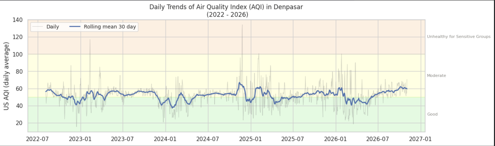

#### Baseline figures

* **Very stable.** The yearly average AQI moved only between 50.6 and 52.9. Among full years, it
  ranged from 51.2 (2024) to 52.9 (2023). The years 2022 (August–December) and 2026
  (January–October) are partial, so their figures are indicative only.
* **No trend.** The average changed by −3.2% in 2024, +2.0% in 2025, and +0.1% in the first ten
  months of 2026. The air is neither clearly improving nor getting worse.
* **Unhealthy days are rare and come in one season.** Only **5 of 1,548 days (0.3%)** exceeded AQI
  100: one each in 2023, 2025, and 2026, and two in 2024. All fell between November and February.
* **Seasons barely differ on average.** The dry season averaged 52.4 and the wet season 51.3, a gap
  of just 1 point.

The risk lies less in a "bad season" than in **short, sharp episodes**, which is exactly what a
daily forecast is meant to catch.

<!-- FIGURE PLACEHOLDER: yearly average AQI and share of days above AQI 100, with partial years marked (notebook Section 4.5.2).
     Save the image as assets/readme/annual_kpis.png, then replace this comment with:
     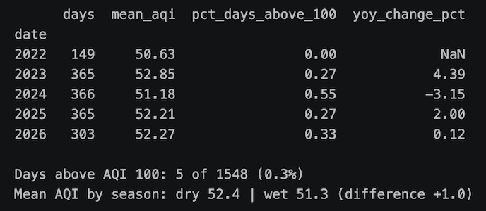
-->

#### Monthly pattern per year

* **Years differ more than months.** Monthly averages stayed between about 41 and 66 in every year.
  The same month can differ by up to 17 points from one year to the next, as February does, so the
  calendar alone is a weak predictor.
* **August–October** sits at about 50–60 every year, in line with the late dry season.
* **April** is among the two cleanest months in 2023, 2024, and 2025.
* **November 2024** has the highest monthly average (about 66), but it is a one-off. It coincides
  with a CAMS model update on 12 November 2024, so part of the jump may come from the change in the
  estimation model rather than from the air itself.

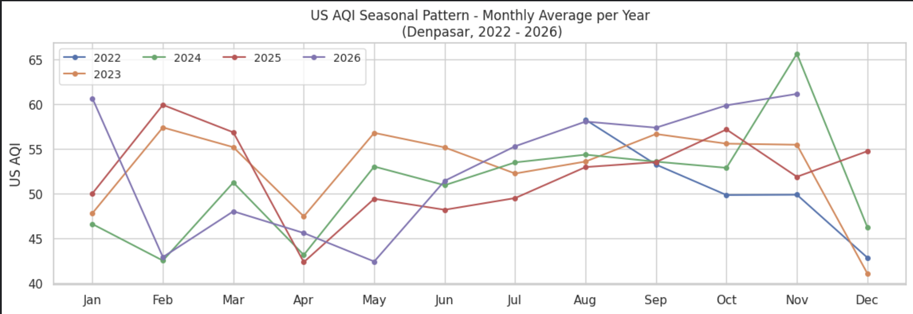

#### Weather trends

The weather follows Bali's monsoon cycle clearly, year after year:

* **Temperature** (30-day average 24–28 °C) is lowest in July–September, during the cool, dry east
  monsoon, and highest in November–January.
* **Rain** falls mostly in December–March and almost stops in July–September. One extreme day of
  137 mm occurred in the second half of 2025.
* **Hours of rain** peak at 16–18 hours a day in the wettest months and fall to about 5 hours in
  June–September. The weaker peak in early 2024 fits the drier conditions after the 2023 El Niño.
* **Wind** (30-day average 11–23 km/h) is strongest in July–September and weakest between the
  monsoons, in April–May and October–November.
* **Sunlight** peaks in October–November, when skies are clear. Sunlight helps form ozone, a
  pollutant.

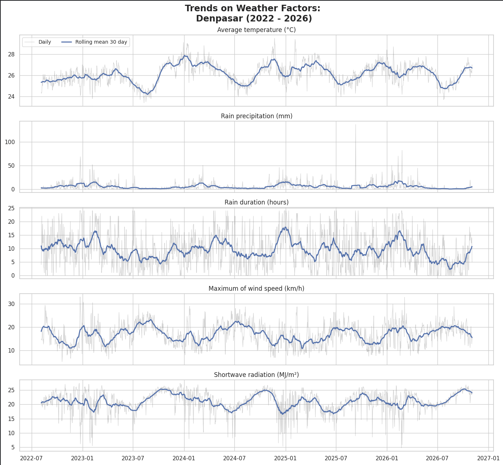

#### Pollutant trends

* **PM2.5** (30-day average 8–18 µg/m³) stays **above the WHO annual guideline the whole time**.
  Its largest episode, in November–December 2024, reached a daily value of about 55 µg/m³.
* **A jump in November 2024.** Carbon monoxide doubled or more, from about 200 to 400–700 µg/m³,
  exactly when CAMS updated its model (version 49r1). Nitrogen dioxide rose and PM10 fell at the
  same time. Sudden, simultaneous jumps like these point to **a change in the estimation model, not
  in actual emissions.**
* **Sulphur dioxide** stepped up in mid-2023 with no matching CAMS update. This is an **open
  data-quality question**.
* **Ozone** moves between 40 and 80 µg/m³, highest in early 2025 and early 2026.
* **Dust** has been close to zero since mid-2023 and carries almost no information.

The November 2024 change is passed to the model as a marker, and dust is left out of the model.

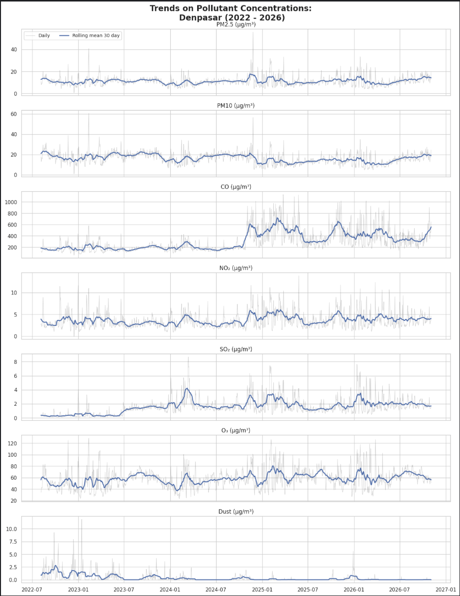

#### Which factors move with the AQI?

This uses **Spearman correlation (ρ)**, which measures how consistently two things rise and fall
together. It runs from −1 (always opposite) to +1 (always together), and 0 means no consistent
link. Each pair of values below is for the same day and the next day.

* **Particles dominate.**
  * PM2.5 has the strongest link (ρ = 0.91 / 0.89).
  * PM10 (0.80 / 0.79) and ozone (0.64 / 0.60) follow.
  * NO₂, SO₂, and CO are moderate to weak.

  Because the AQI is calculated *from* pollutant levels, and PM2.5 usually sets it, these links
  are partly built in. They confirm PM2.5 as the pollutant to focus on, but they **do not prove
  cause and effect.**
* **Weather matters less, and indirectly.**
  * Longer rain (−0.25 / −0.27) and more rain (−0.18 / −0.20) go with cleaner air.
  * Sunlight is weakly linked to worse air.
  * Temperature and wind show almost no direct link.
* **Wind clears traffic gases.** Stronger wind clearly lowers NO₂ (ρ = −0.56) and CO (−0.41), even
  though its direct link to the AQI is weak.
* **Shared sources.** CO, NO₂, and SO₂ rise and fall together, which points to common combustion
  sources such as traffic and burning.
* **Today predicts tomorrow.** Today's AQI and tomorrow's are strongly linked (ρ = 0.76), so recent
  AQI values are useful forecast inputs.

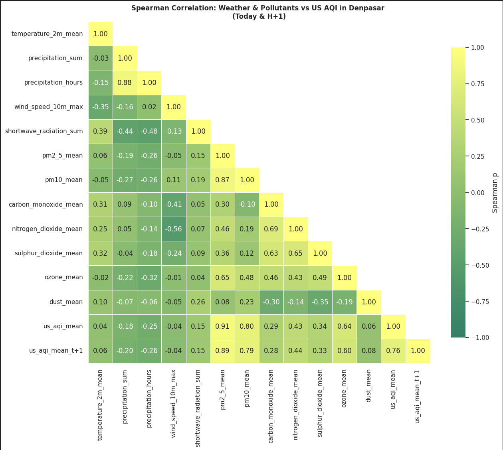

#### The shape of these relationships

* **Rain helps, with diminishing returns.** Next-day AQI falls from about 54 on dry days to about
  35 at roughly 70 mm of rain, then levels off.
* **Wind helps only up to a point.** AQI falls from about 60 at 5 km/h to about 52 at 15 km/h and
  barely changes beyond that.
* **Strong sunlight signals dry weather.** AQI rises from about 40 to about 53 as sunlight
  increases, in line with clear, dry days and ozone formation.
* **Temperature shows no visible relationship.**
* **PM2.5 has a turning point.** The AQI rises much faster below about 10 µg/m³ than above it. This
  matches the official AQI formula, which switches from *Good* to *Moderate* around 9–12 µg/m³.

These "threshold" and "levelling-off" shapes suit tree-based models, which learn such patterns
without manual adjustments.

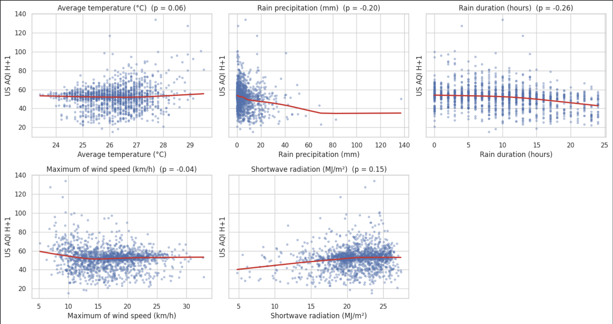

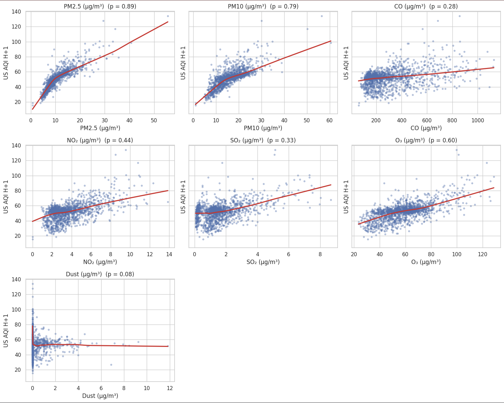

#### How much does today depend on yesterday?

* **Short memory.** Each day strongly resembles the day before, a little the day before that, and
  hardly at all after about four days.
* **No weekly pattern.** Weekdays and weekends look the same: the typical AQI differs by only 1.2
  points between the cleanest and dirtiest weekday. Day-of-week inputs are not needed.
* **Seasons matter for planning, not day to day.** The yearly cycle explains only 4.4% of the
  day-to-day ups and downs, but 19.8% of the differences between monthly averages.
* **A gentle, lopsided yearly cycle.** The seasonal effect peaks in **mid-September** (about +4
  AQI) and is lowest in **late April** (about −2.7). Air quality worsens quickly from May to
  September and improves slowly from October to April. The whole swing is only about 6.7 points.
* **Episodes are not seasonal.** Removing the seasonal pattern leaves the spikes of February 2023,
  November–December 2024, and January–February 2026 intact, so most variation has other causes.
* **A recent upward drift.** From July to October 2026, the AQI with the season removed rose to its
  highest sustained level in the period. This followed another CAMS update in May 2026 and deserves
  monitoring.

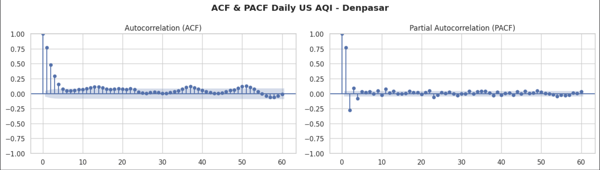

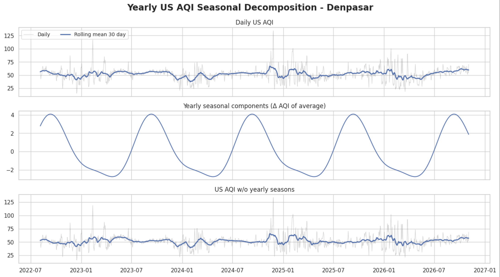

#### Is the series stable over time?

Three statistical tests agree that the AQI moves around a steady average rather than drifting
away from it. This means the model can forecast AQI levels directly. One test also finds a
**likely break on 30 June 2026**, about seven weeks after the May 2026 CAMS update. That date falls
inside the test period, which makes the test a demanding one.

#### Summary of the exploration

1. **Baseline.** The AQI averages 52, at the lower edge of *Moderate*, with short, rare spikes above
   100. PM2.5 stays above the WHO annual guideline throughout.
2. **Drivers.** PM2.5 is the pollutant most closely tied to the AQI. Rain lowers next-day AQI with
   diminishing returns, and wind mainly disperses combustion gases.
3. **Behaviour over time.** Stable, with a short memory, no weekly pattern, and a weak yearly cycle
   that peaks in September.
4. **Changes in the data source.** CAMS updates (November 2024 and May 2026) and an unexplained SO₂
   step in 2023 shift some levels, and the model must account for this.

### 4.6 From Exploration to Preparation

| What the exploration found | What the preparation does |
|---|---|
| Each day depends mainly on the previous two days | Use the AQI of the last two days, plus 7- and 30-day averages, highs, and variability |
| A weak, lopsided yearly cycle | Add two smooth time-of-year signals |
| No weekday effect | No day-of-week inputs |
| Rain lowers next-day AQI, with diminishing returns | Add today's rain plus 3- and 7-day rain totals |
| The series is stable | Forecast AQI levels directly |
| CAMS update in November 2024 | Mark each day as before or after the update (the May 2026 update is used only in evaluation) |
| Dust is near zero since 2023 | Leave dust out |
| Some inputs are nearly identical | Remove near-duplicates, using the training period only |
| A break inside the test period | Strict date-based split with a gap; results reported per CAMS version |

---

## 5. Data Preparation

The preparation runs in **four phases**. Each phase is designed so that **no information from the
future leaks into the past**, which would make the model look better than it really is.

### 5.1 Phase A: Before the Split

* **Dashboard data first.** The clean daily data, with year, month, season, AQI category, and CAMS
  version added, are saved for the dashboard before any modelling starts. The dashboard therefore
  shows the original measured values.
* **Inputs use only the past.** Every input for a given day uses only that day and earlier days.
  Short gaps in weather or pollutant data are filled with the last known value, never a future one.
* **Targets.** The values to predict are the AQI on each of the next seven days.
* **Trimming.** Twenty columns that are identifiers, duplicates, or unused are removed. The first
  29 days are dropped because they lack a full 30-day history, and the last 7 days are dropped
  because their future AQI is not yet known.

**Result:** **1,512 days** (3 September 2022 – 23 October 2026), with **27 inputs** and **7 targets**
each.

### 5.2 Phase B: Splitting by Date

The days are split in time order, without shuffling:

| Period | Dates | Days |
|---|---|---|
| Training (65%) | 3 Sep 2022 – 6 May 2025 | 977 |
| Validation (15%) | 13 May – 19 Dec 2025 | 221 |
| Test (20%) | 26 Dec 2025 – 23 Oct 2026 | 302 |

A **6-day gap** separates the periods. Without it, the 7-day targets of the last training days
would overlap the next period. The test period includes the May 2026 CAMS update and the 30 June
2026 break, which makes it a tough, realistic check.

### 5.3 Phase C: Learning from the Training Period Only

Every step that learns from data uses the training period only, so the later periods stay unseen.

* **Near-duplicate inputs.** No pair of inputs is almost identical, so all 27 are kept.
* **Sanity check.** A quick model shows that the inputs carry real signal. Scrambling PM2.5 hurts
  its accuracy far more than scrambling any other input. This is partly built in, because the AQI
  is calculated from PM2.5, so the check is used only to confirm signal, not to choose inputs.

### 5.4 Phase D: Ready for Modelling

The training and validation periods are combined, then divided into **10 consecutive test rounds**.
Each round trains on everything before it and tests on the next stretch of about 3.5 months, from
December 2022 to December 2025. Every season is tested several times, so the comparison reflects
the whole year, not one lucky period.

---

## 6. Modelling

### 6.1 Candidate Methods

* **Gradient Boosting:** adds small decision trees one after another, each fixing the errors of the
  last. It is strong on table-like data, but sensitive to its settings.
* **Random Forest:** averages many larger, independent decision trees. It copes well with noise and
  outliers, and predicts all seven days at once.

**Built-in assumptions**

* The AQI is stable over time, so the models predict AQI levels directly.
* Tree-based models **cannot predict values beyond anything seen in training**, so unprecedented
  spikes will be under-predicted.
* What is known today carries information about the next seven days.

### 6.2 Training and Testing Tools

* Days whose target AQI had to be filled in would count for nothing in training (none occurred
  here).
* Each candidate is scored by its average error over the 10 test rounds and all seven days.
* Tuning tries many settings automatically and stops unpromising attempts early. Every attempt is
  saved for traceability.

### 6.3 Starting Point

Both methods are first trained with their **default settings**, so the benefit of tuning can be
measured without touching the test period.

### 6.4 Tuning

Both methods end up with **cautious settings** that keep them from chasing noise:

* **Gradient Boosting:** best error 9.40, with only 100 small trees learning slowly.
* **Random Forest:** best error 9.32, with 600 trees and at least 29 days in each final branch.

Needing such caution shows that day-to-day AQI changes contain a lot of noise. Some best settings
sit at the edge of the range that was searched, so the range should be widened next time.

### 6.5 Choosing the Model

| Candidate | Average error (RMSE, AQI points) |
|---|---|
| **Random Forest, tuned (chosen)** | **9.32** |
| Gradient Boosting, tuned | 9.40 |
| Random Forest, default (best untuned) | 10.72 |

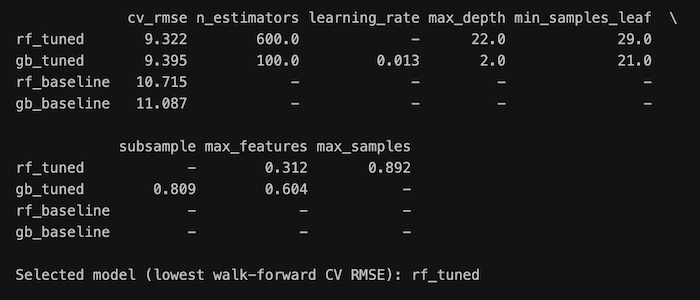

* **Winner:** the tuned Random Forest.
* **Practically a tie:** the gap to Gradient Boosting is only 0.07 points, so both approaches
  capture Denpasar's daily patterns about equally well.
* **Tuning paid off:** it cut the error by 1.39 points, about 13%. Tuned scores are the best of
  many attempts, so they are slightly optimistic.

The chosen model is then tested **once** on the test period.

---

## 7. Evaluation

The chosen model is tested on the held-out period (26 December 2025 – 23 October 2026) and compared
with the two rules of thumb. Sections 7.1–7.7 check the model's accuracy. Sections 7.8–7.10 judge
the results against the goals, review the process, and decide what happens next.

### 7.1–7.3 Setup

* The accuracy measures are the same ones the dashboard uses, so the notebook and the dashboard
  always show identical numbers.
* The two rules of thumb are **persistence** ("every day this week will be like today") and
  **climatology** ("it will be the usual average for that month"). Persistence is hard to beat for
  tomorrow, and climatology is hard to beat for a week ahead.

### 7.4 Test Results

| Measure (average over 7 days) | Model | Persistence | Climatology |
|---|---|---|---|
| RMSE (lower is better) | **11.83** | 16.41 | 13.65 |
| MAE (lower is better) | **8.37** | 11.21 | 9.98 |
| sMAPE (lower is better) | **16.79%** | 21.98% | 19.83% |
| Category accuracy (higher is better) | **76.96%** | 72.47% | 65.37% |

* **A typical forecast is off by about 8 AQI points.**
* **The model beats both rules.** Its RMSE is **27.9% lower than persistence** and **13.3% lower
  than climatology**. Climatology is the harder rule to beat: persistence suffers in the volatile
  January–March 2026 period, while a seasonal average is a safe guess for days far ahead.
* **Most of the skill is in the first three days.**
  * The error grows from 7.43 for tomorrow to 12.51 for day 3, then stays at about 13.0 for days
    4–7. That plateau is close to the error of the seasonal average, so beyond day 3 the forecast
    adds little.
  * The AQI category is right **90.1%** of the time for tomorrow, **78.2%** for day 3, and about
    **71%** from day 5 on.
* **Targets:**
  * Beats both rules on RMSE: **met**.
  * Beats both rules on MAE: **met** (8.37 vs. 9.98).
  * sMAPE of 15% or less: **not met** (16.79%). It is met only for tomorrow (10.39%), and day 2 is
    already at 15.60%.

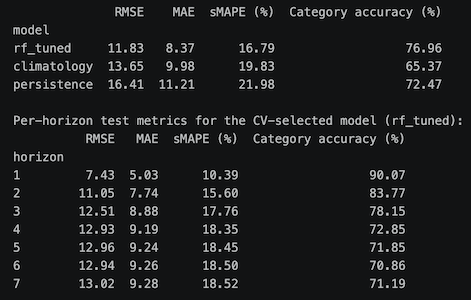

### 7.5 Forecast vs. Reality

* **Tomorrow's forecast** follows the actual AQI closely, especially after mid-May 2026, when the
  air became calmer.
* **Extremes are softened.** In the volatile January–March 2026 period, peaks of 80–100 were
  under-forecast by about 20–30 points, and dips to 20–30 were over-forecast. Tree-based models
  average similar past days, which pulls forecasts towards the middle.
* **The week-ahead forecast** is almost flat, between about 48 and 55. It behaves like a seasonal
  average and cannot foresee individual episodes a week in advance.
* **After the May 2026 CAMS update** errors shrink, because the series is calmer. From August 2026,
  however, the actual AQI drifted up to 60–68 while the week-ahead forecast stayed near 55.

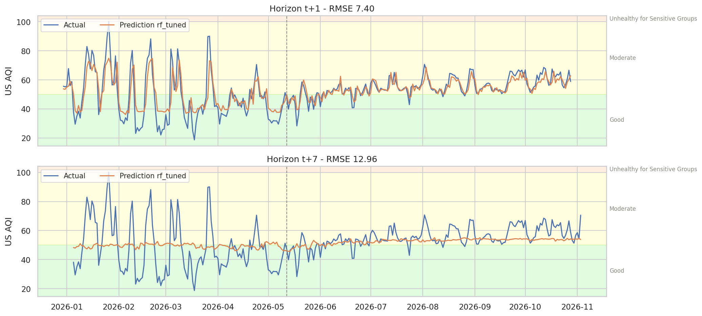

### 7.6 Looking at the Errors

* **No built-in bias.** For tomorrow's forecast, the 30-day average error stays within about ±4 AQI
  points.
* **The biggest misses come during episodes**, up to +40 and −30, in January–March 2026.
* **Errors grow with the forecast distance** up to about day 4, then stay similar.
* **Recent under-forecasting.** From August to October 2026, forecasts for days 4 and 7 were
  consistently 5–8 points too low, missing the recent upward drift.
* **Errors follow each other.** Today's error partly predicts tomorrow's. A correction step that
  adds yesterday's error to today's forecast could improve accuracy.

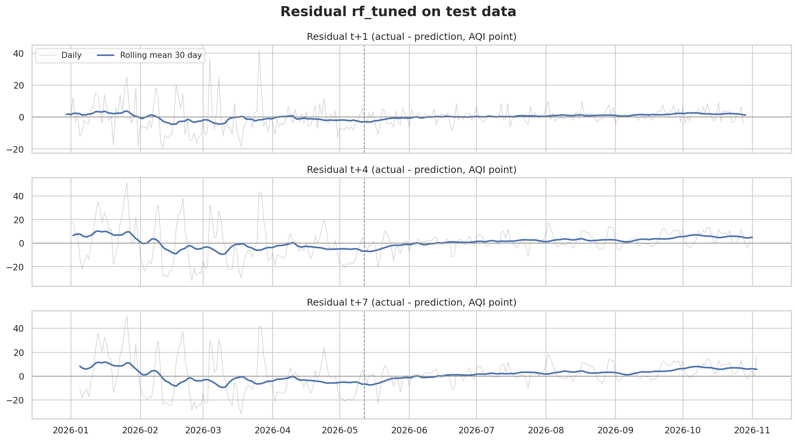

### 7.7 What the Model Relies On

This is measured by **feature importance**: scramble one input and see how much worse the forecast
gets.

* **Top three:** PM2.5 (about 0.75 AQI points worse when scrambled), PM10 (0.27), and the
  **variability of the AQI over the past 30 days** (0.16). They are followed by today's AQI, ozone,
  the highest AQI of the past 30 days, and NO₂.
* **A turbulent month is a warning sign.** The model treats recent ups and downs as a sign of more
  to come.
* **Weather plays a minor role.** The only weather input in the top ten is the 7-day rain total,
  which matches the weak direct links found earlier.

Inputs that carry similar information share the credit, so the importance of PM2.5 and recent AQI
should be read together.

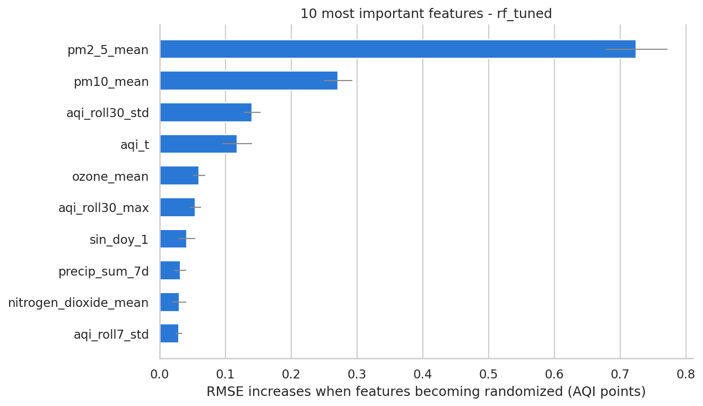

### 7.8 Did It Meet the Success Criteria?

| ID | Criterion | Evidence | Status |
|---|---|---|---|
| B1 | A clear picture of air quality | Baseline figures, seasonal risk windows, and the dashboard data | Achieved |
| B2 | Targeted clean-air measures | Ranking of factors, the model's key inputs, and early-warning signals | Achieved |
| B3 | Warnings before the air worsens | Category accuracy 76.96% vs. 72.47% for the better rule | Achieved |
| D1 | Baseline figures | Yearly table | Achieved |
| D2 | Ranking of factors | Correlation ranking and feature importance | Achieved |
| D3 | Model choice | Tuned Random Forest, error 9.32 | Achieved |
| D4 | Better than rules of thumb | RMSE 11.83 vs. 13.65; MAE 8.37 vs. 9.98 | Achieved |
| D5 | sMAPE 15% or less | 16.79% (met only for tomorrow: 10.39%) | **Not achieved** |

**Seven of eight criteria are met.** The one miss concerns week-ahead accuracy, not the short-range
forecasts that matter most for warnings.

### 7.9 Reviewing the Process

**What worked**

* The safeguards against "seeing the future" held throughout.
* The test period was used only once, after the model was chosen.
* Fixed random seeds, a data version code, and saved files make every result traceable.

**What to improve next time**

* **Fix all targets before modelling.** The percentage-error target was switched from MAPE to sMAPE
  after early results were seen.
* **Widen the tuning ranges**, because several best settings sat at the edge.
* **Make tuning exactly repeatable.** Re-running in the same session adds new attempts to the
  previous ones.
* **Use a richer seasonal signal.** Statistics favour three or four time-of-year signals over the
  two used.
* **Improve the week-ahead forecast.** The most promising fixes are weather forecasts as inputs and
  an error-correction step.
* **Clarify data issues with the provider:** the 2023 SO₂ step and the negative values in the raw
  data.

### 7.10 Decision

| Outcome | Decision |
|---|---|
| All criteria met | Approve the model for daily warnings |
| Useful, but the sMAPE target is missed | **Approve it as supervised decision support**, and run one more improvement round before full adoption |
| A rule of thumb is not beaten | Do not adopt; go back to preparation and modelling |

**Decision: approve the tuned Random Forest as supervised decision support, and run one more
improvement round** (the middle row).

* **It is useful.** It beats both rules of thumb and gets the AQI category right more often.
* **It is not yet accurate enough to run alone.** It misses the 15% sMAPE target, and accuracy
  drops after day 3.

**Conditions of use**

1. **Days 1–3 can support warnings.** They get the category right 78–90% of the time. Days 4–7
   should be communicated as an **outlook** only.
2. **A person stays in charge.** An analyst at the health service or the environment agency (DLH)
   confirms every warning before it is published.
3. **Keep the model fresh.** Retrain it monthly and after every CAMS update, and keep tracking how
   often the category is right.

**To pass the next round:**

* average sMAPE of 15% or less on a new test period that is fixed in advance;
* category accuracy for days 4–7 better than "tomorrow will be like today".

---

## 8. Forecasting and Export

### 8.1 Retraining on All Data

After evaluation, the chosen model is retrained on every available day, including the test period,
so that the forecast reflects the most recent conditions.

### 8.2 The 7-Day Forecast

The forecast starts from the latest day with complete data. Each day has a **likely range**
(P10–P90): based on the model's past errors, the actual value falls inside this range about
8 times out of 10. Because the range comes from real past errors, it reflects how the model
actually performed, not theory.

| | |
|---|---|
| **Forecast week** | 31 October – 6 November 2026 |
| **Forecast AQI** | 54.0 to 55.9, all days *Moderate* |
| **Likely range, tomorrow** | 46.1 to 61.2 (about 15 points wide) |
| **Likely range, day 7** | 37.9 to 69.4 (about 31 points wide) |
| **Warning needed?** | **No.** Even the highest upper limit (69.8) is well below AQI 100. |

The forecast sits slightly above the late-October readings, in line with the recent upward drift.

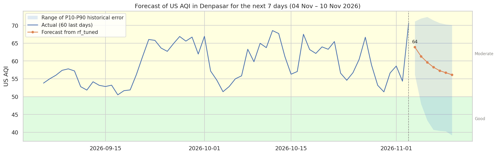

### 8.3 Files for the Dashboard

The model's predictions for every period, and its accuracy grouped by period, forecast day, and
CAMS version, are saved for the dashboard. They use the same accuracy measures as the notebook, so
both always show the same numbers.

---

## 9. Conclusion and Recommendations

### 9.1 Conclusion

**In one sentence:** Denpasar's air is *Moderate* on most days, its worst days follow recognisable
conditions, and a 7-day forecast turns that knowledge into advance warning.

* **Air quality baseline (Goal 1).**
  * Between August 2022 and October 2026, the air was consistently *Moderate*. The yearly average
    AQI stayed between 50.6 and 52.9, with no trend.
  * Only 5 days (0.3%) went above AQI 100, all between November and February.
  * The dry and wet seasons differ by just 1 point on average.
  * **Fine particles are the main concern:** average PM2.5 (11.0 µg/m³) is more than twice the WHO
    annual guideline.
* **What makes bad days (Goal 2).**
  * PM2.5 tracks the AQI most closely (ρ = 0.91), followed by PM10 and ozone.
  * Rain cleans the air, with diminishing returns.
  * Wind mainly disperses combustion gases such as NO₂ and CO.
  * Temperature shows no clear link in this data, unlike earlier findings during Nyepi.

  Together, this supports the local evidence that **people set the pollution load, and the weather
  decides how much of it lingers.**
* **Forecasting (Goal 3).** The tuned Random Forest forecasts seven days ahead with an average miss
  of about 8 AQI points (MAE 8.37, RMSE 11.83, sMAPE 16.79%).
  * It **beats both rules of thumb**: its RMSE is 27.9% lower than persistence and 13.3% lower than
    climatology.
  * It **misses the 15% sMAPE target**, which it meets only for tomorrow (10.39%).
  * It gets the AQI category right **76.96%** of the time, against 72.47% for the better rule.
  * It is most reliable for the first three days (78–90%). It is approved as **supervised decision
    support**, with one more improvement round planned.
* **Reliability depends on looking after the data.** CAMS updates shift some pollutant levels, and
  model-based estimates differ from ground measurements. Regular retraining and checks against
  ground stations are needed before routine use.

### 9.2 Were the Problems Addressed?

1. **A clear picture of air quality: addressed** [B1, D1]. The baseline figures, trend and seasonal
   analyses, and the dashboard give one consistent picture. Two risk windows are now clear:
   * a mild rise late in the dry season, peaking in **September**;
   * short, sharp episodes in **November–February**, when all five days above AQI 100 occurred.
2. **Measured drivers: addressed** [B2, D2]. The correlation ranking and relationship curves show
   which pollutants and weather conditions move with the AQI. The model's key inputs (PM2.5, PM10,
   and recent AQI variability) confirm what the forecast relies on.
3. **A short-term forecast: partly addressed** [B3, D3–D5]. A 7-day forecast with likely ranges and
   AQI categories exists and beats both rules of thumb. It is reliable for the first three days but
   misses the sMAPE target over the full week. Random Forest edged out Gradient Boosting (9.32 vs.
   9.40), close enough to call it a practical tie.

### 9.3 Were the Goals Achieved?

| Goal | Result | Status |
|---|---|---|
| 1. Air quality baseline | Yearly average AQI 50.6–52.9, no trend; 5 days above 100 (0.3%); dry 52.4 vs. wet 51.3 | Achieved |
| 2. Key factors | PM2.5 ρ = 0.91, PM10 0.80, ozone 0.64; hours of rain −0.25; model relies most on PM2.5, PM10, and recent AQI variability | Achieved |
| 3. Reliable 7-day forecast | Tuned Random Forest; RMSE 11.83 vs. 13.65 and MAE 8.37 vs. 9.98 (better rule of thumb); sMAPE 16.79%; category accuracy 76.96% vs. 72.47% | Partly achieved (sMAPE target missed) |

### 9.4 Did It Make a Difference?

* **From reacting to preparing.** More than 37,000 hourly records are condensed into a handful of
  figures and risk windows that anyone can read in minutes, and the dashboard puts them in front of
  decision-makers.
* **Earlier warnings, fewer missed spikes.**
  * Health services and city agencies get **up to 3 days of usable warning time**, with the AQI
    category right 78–90% of the time, instead of reacting after the air has worsened.
  * Across all seven days, 76.96% of forecasts land in the correct category.
  * This addresses the cost imbalance in Section 2.3: a missed spike costs more than an
    unnecessary warning.
* **Trustworthy by design.** The results are reproducible and auditable, which public
  decision-making requires:
  * inputs that never use future data;
  * a date-based split with a gap;
  * model choice before a single final test;
  * versioned output files.

### 9.5 Recommendations

1. **Tackle PM2.5 at its local sources.** *Who: the city and provincial environment agencies
   (DLH).* PM2.5 drives the AQI and stays above the WHO guideline throughout. Priority sources:
   * open waste burning, which increased after the Suwung landfill closure;
   * landfill fires, such as the October 2023 Suwung fire;
   * traffic and construction dust.

   Nyepi shows how quickly the air responds when these activities stop.
2. **Adopt a two-tier early-warning rule.** *Who: health services (Dinas Kesehatan) with DLH.*
   * **Tier 1:** issue a public advisory when the forecast, or the upper end of its likely range,
     exceeds AQI 100 within the next three days.
   * **Tier 2:** raise the alert level when this coincides with dry weather (no rain for three or
     more days) and weak wind (below about 15 km/h), the conditions with the highest AQI.
3. **Prepare for two risk windows.** *Who: the city government and DLH.*
   * **August–October:** schedule waste-burning inspections, roadside emission checks, and dust
     control on construction sites, ahead of the September peak.
   * **November–February:** keep rapid-response teams on standby: fire crews for landfill fires,
     open-burning patrols, and public messaging. All five days above AQI 100 fell in this window.
4. **Communicate daily, not monthly.** *Who: health services and tourism operators.* Pollution
   spikes last only a few days, so residents and visitors need daily updates through the dashboard
   and messaging channels.
5. **Check the model against ground measurements.** *Who: DLH with the project data team.* Compare
   the CAMS estimates with readings under Indonesia's official air pollution index (**ISPU**).
   Studies show that correcting CAMS with ground measurements substantially improves PM2.5
   forecasts.
6. **Run and maintain the model.** *Who: the project data team.*
   * Refresh the forecast daily.
   * Retrain at least monthly, and after every CAMS update.
   * Track how often the AQI category is right, to spot problems early.

### 9.6 Limitations and Future Work

* **Model-based data.** CAMS estimates can shift when the model is updated (November 2024 and May
  2026), and they differ from ground measurements. The 2023 SO₂ step remains unexplained.
* **Short history.** About four years of data cover only four yearly cycles, which limits how well
  the seasons can be learned.
* **No weather forecasts as inputs.** The model only knows today's weather. Adding weather forecasts
  for the coming week would likely improve days 4–7, which currently drift towards the seasonal
  average.
* **Few extreme days to learn from.** Only 5 days exceeded AQI 100, so the model under-predicts
  spikes. Methods built for extremes, such as models of the upper range or a dedicated spike
  detector, are a natural next step.
* **Scope of factors.** Which pollutant sets the AQI on each day, and human-activity data such as
  traffic, tourist arrivals, or waste-burning reports, are not part of this analysis. They are
  natural next steps for targeting specific sources.
* **Approximate likely range.** The P10–P90 range is estimated from the model before its final
  retraining, so it approximates, rather than guarantees, the final model's coverage.

---

## How to Run

**The quickest way:** open the online dashboard at [https://YOUR-APP-NAME.streamlit.app](https://YOUR-APP-NAME.streamlit.app). Nothing to install.
<!-- STREAMLIT CLOUD PLACEHOLDER: replace YOUR-APP-NAME with the deployed app's address. -->

To run it on your own computer, follow the steps below. You don't need to run the notebook to use
the dashboard. The repository already includes the files
it reads: the clean daily data and the forecast in `data/processed/`, and the model settings in
`artifacts/`.

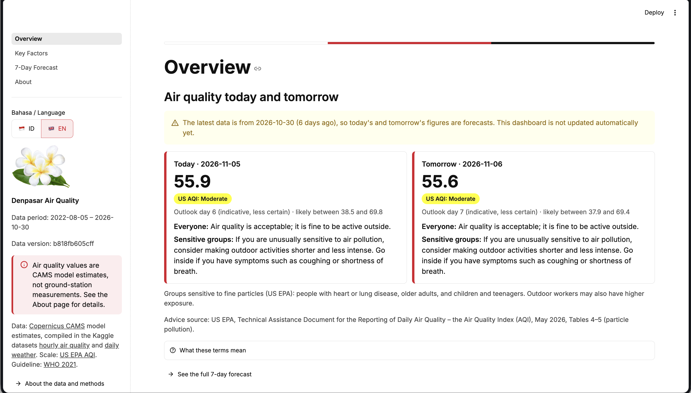

### What you need

* **Python 3.13**
* **Git**, to download the repository

### 1. Download the project

```bash
git clone <repository-url>
cd denpasar-air-quality-forecasting
```

### 2. Install the dependencies

Create a separate Python environment, so the project does not affect other Python work on your
computer, then install the pinned packages. `requirements.txt` also installs the project's shared
package, `aqi_forecasting`, from `src/`.

```bash
python3.13 -m venv .venv
source .venv/bin/activate          # Windows: .venv\Scripts\activate
pip install -r requirements.txt
```

If you use conda, create an environment with `conda create -n aqi python=3.13`, activate it, and
run the same `pip install -r requirements.txt` inside it.

### 3. Start the dashboard

```bash
streamlit run dashboard/app.py
```

The dashboard opens in your browser at http://localhost:8501. It has four pages:

| Page | What it shows |
|---|---|
| **Overview** | Today's and tomorrow's air quality with health advice, plus trends, yearly figures, seasons, and unhealthy days |
| **Key Factors** | Which pollutants and weather conditions move with the AQI, and what the model relies on |
| **7-Day Forecast** | The forecast with its likely range, warning status, and how reliable it has been |
| **About** | Where the data come from, how to read the AQI, the model, conditions of use, and limitations |

The language follows your browser (Indonesian or English) and can be switched in the sidebar.

**Note on dates.** The data end on 30 October 2026, and the dashboard does not update itself. Each
day after that, "today" and "tomorrow" fall further into the forecast, and the dashboard says so.

### 4. Run the tests (optional)

The tests check the shared code, the data files, and every dashboard page in both languages.

```bash
pip install -r requirements-dev.txt
pytest
```

### Project layout

| Folder | Contents |
|---|---|
| `notebooks/` | The analysis notebook, the source of every number |
| `data/processed/` | Clean daily data, the 7-day forecast, and model predictions, exported by the notebook |
| `artifacts/` | The trained model and its settings, exported by the notebook |
| `src/aqi_forecasting/` | Code shared by the notebook and the dashboard: settings, inputs, and accuracy measures |
| `dashboard/` | The Streamlit app, with its pages, translations (`locales/`), and images (`assets/`) |
| `tests/` | Automated tests |
| `assets/readme/` | Images used in this README |

---

## Glossary

| Term | Meaning |
|---|---|
| **US AQI** | The US Air Quality Index. It turns pollutant levels into one number from 0 to 500: 0–50 *Good*, 51–100 *Moderate*, 101–150 *Unhealthy for Sensitive Groups*, 151–200 *Unhealthy*, 201–300 *Very Unhealthy*, 301+ *Hazardous*. It is **not** the same as Indonesia's ISPU, whose thresholds differ. |
| **PM2.5 / PM10** | Airborne particles up to 2.5 or 10 micrometres across. PM2.5 is small enough to reach deep into the lungs. |
| **µg/m³** | Micrograms per cubic metre of air, the unit for pollutant amounts. |
| **CAMS** | The Copernicus Atmosphere Monitoring Service, which estimates air quality worldwide with computer models. Its model updates (versions 49r1 in November 2024 and 50r1 in May 2026) can shift pollutant levels. |
| **WHO guideline** | The World Health Organization's recommended limits. For PM2.5: 5 µg/m³ as a yearly average and 15 µg/m³ as a daily average (2021). |
| **Dry / wet season** | April–October / November–March. |
| **Spearman correlation (ρ)** | How consistently two things rise and fall together, from −1 to +1. It does not prove cause and effect. |
| **RMSE / MAE** | Typical forecast error in AQI points. RMSE gives extra weight to large misses. Lower is better. |
| **sMAPE** | Average forecast error as a percentage. Lower is better. |
| **Category accuracy** | How often the forecast lands in the same AQI category as what actually happened. |
| **Persistence / climatology** | The two rules of thumb: "tomorrow will be like today" and "it will be the usual average for this month". |
| **P10–P90 (likely range)** | The range the actual value fell into about 8 times out of 10, based on the model's past errors. |
| **Walk-forward cross-validation** | Testing a model several times, each time training on the past and testing on the period that follows. |
| **Random Forest / Gradient Boosting** | Two machine-learning methods that combine many simple decision trees. |
| **CRISP-DM** | A standard step-by-step method for data projects. |

---

## References

All sources were published in 2019 or later. Citations follow APA 7th edition.

### News articles

Erviani, N. K. (2026, April 27). Bali trash issues raise concerns after landfill closure. *The
Jakarta Post*; republished by Asia News Network.
https://asianews.network/bali-trash-issues-raise-concerns-after-landfill-closure/

Rhismawati, N. L. (2023a, October 12). BPBD Denpasar: Hampir separuh TPA Suwung terbakar [Denpasar
disaster agency: Nearly half of the Suwung landfill has burned]. *ANTARA News Bali*.
https://bali.antaranews.com/berita/327429/bpbd-denpasar-hampir-separuh-tpa-suwung-terbakar

Rhismawati, N. L. (2023b, October 13). Denpasar keluarkan status tanggap darurat bencana kebakaran
di TPA Suwung [Denpasar declares a fire emergency at the Suwung landfill]. *ANTARA News Bali*.
https://bali.antaranews.com/berita/327540/denpasar-keluarkan-status-tanggap-darurat-bencana-kebakaran-di-tpa-suwung

Suadnyana, I. W. S. (2023, October 13). Polisi bagi-bagi masker ke warga terdampak kebakaran TPA
Suwung [Police distribute masks to residents affected by the Suwung landfill fire]. *detikBali*.
https://www.detik.com/bali/berita/d-6981222/polisi-bagi-bagi-masker-ke-warga-terdampak-kebakaran-tpa-suwung

### Official statistics, reports, and regulations

Badan Pusat Statistik Provinsi Bali. (2026, February 2). *Bali's foreign arrivals Jan–Dec 2025 rise,
with Australia remaining the largest contributor overall* [Press release].
https://bali.bps.go.id/en/news/2026/02/02/347/bali-s-foreign-arrivals-jan-dec-2025-rise--with-australia-remaining-the-largest-contributor-overall-.html

Energy Policy Institute at the University of Chicago. (2025). *Air Quality Life Index: Indonesia
fact sheet*. https://aqli.epic.uchicago.edu/hi/files/Indonesia%20FactSheet_2025.pdf

Kementerian Lingkungan Hidup dan Kehutanan. (2020). *Peraturan Menteri Lingkungan Hidup dan
Kehutanan Nomor 14 Tahun 2020 tentang Indeks Standar Pencemar Udara* [Regulation of the Minister of
Environment and Forestry No. 14 of 2020 on the Air Pollutant Standard Index].
https://peraturan.bpk.go.id/Details/163466/p

World Health Organization. (2021). *WHO global air quality guidelines: Particulate matter (PM2.5 and
PM10), ozone, nitrogen dioxide, sulfur dioxide and carbon monoxide*.
https://www.who.int/publications/i/item/9789240034228

### Scientific papers

Cerqueira, V., Torgo, L., & Mozetič, I. (2020). Evaluating time series forecasting models: An
empirical study on performance estimation methods. *Machine Learning, 109*(11), 1997–2028.
https://doi.org/10.1007/s10994-020-05910-7

Chianese, E., & Riccio, A. (2026). Multi-model ensemble approaches in air quality prediction: A
comprehensive review from chemical transport models to hybrid machine learning. *Atmosphere,
17*(7), Article 689. https://doi.org/10.3390/atmos17070689

Hewamalage, H., Ackermann, K., & Bergmeir, C. (2023). Forecast evaluation for data scientists:
Common pitfalls and best practices. *Data Mining and Knowledge Discovery, 37*(2), 788–832.
https://doi.org/10.1007/s10618-022-00894-5

Inness, A., Ades, M., Agustí-Panareda, A., Barré, J., Benedictow, A., Blechschmidt, A.-M.,
Dominguez, J. J., Engelen, R., Eskes, H., Flemming, J., Huijnen, V., Jones, L., Kipling, Z.,
Massart, S., Parrington, M., Peuch, V.-H., Razinger, M., Remy, S., Schulz, M., & Suttie, M. (2019).
The CAMS reanalysis of atmospheric composition. *Atmospheric Chemistry and Physics, 19*(6),
3515–3556. https://doi.org/10.5194/acp-19-3515-2019

Kolassa, S. (2026). The symmetric mean absolute percentage error: Unnecessary or dangerous.
*Forecasting, 8*(2), Article 24. https://doi.org/10.3390/forecast8020024

Lacima, A., Petetin, H., Soret, A., Bowdalo, D., Jorba, O., Chen, Z., Méndez Turrubiates, R. F.,
Achebak, H., Ballester, J., & Pérez García-Pando, C. (2023). Long-term evaluation of surface air
pollution in CAMSRA and MERRA-2 global reanalyses over Europe (2003–2020). *Geoscientific Model
Development, 16*(9), 2689–2718. https://doi.org/10.5194/gmd-16-2689-2023

Méndez, M., Merayo, M. G., & Núñez, M. (2023). Machine learning algorithms to forecast air quality:
A survey. *Artificial Intelligence Review, 56*, 10031–10066.
https://doi.org/10.1007/s10462-023-10424-4

Nuraini, T. A., Satyaningsih, R., Permana, D. S., Anggraeni, R., & Aldrian, E. (2019). Comparison
of total suspended particulate (TSP) measurement in urban and suburban areas of Bali during Nyepi
Day 2015. *Forum Geografi, 33*(2), 173–183. https://doi.org/10.23917/forgeo.v33i2.8670

Nuryanto, D. E., Permana, D. S., Hidayanto, N., Rizal, J., Heriyanto, E., Harapan, F. A.,
Fajariana, Y., & Komalasari, K. E. (2024). The effect of human activities on Bali's Silent Day
(Nyepi) in 2022. *E3S Web of Conferences, 485*, Article 06010.
https://doi.org/10.1051/e3sconf/202448506010

Suryadhi, M. A. H., Suryadhi, P. A. R., Abudureyimu, K., Ruma, I. M. W., Calliope, A. S., Wirawan,
D. N., & Yorifuji, T. (2020). Exposure to particulate matter (PM2.5) and prevalence of diabetes
mellitus in Indonesia. *Environment International, 140*, Article 105603.
https://doi.org/10.1016/j.envint.2020.105603

Wu, C., Li, K., & Bai, K. (2020). Validation and calibration of CAMS PM2.5 forecasts using in situ
PM2.5 measurements in China and United States. *Remote Sensing, 12*(22), Article 3813.
https://doi.org/10.3390/rs12223813

---

<p align="center">Copyright © 2026 Dwi Cahaya Dharma</p>
